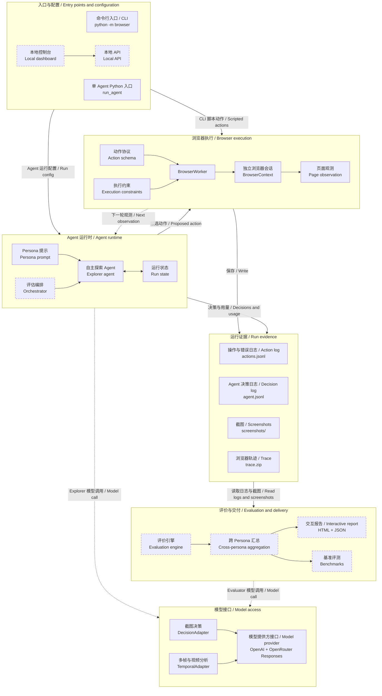

# UX-verse

## 浏览器基础 / Browser foundation

第一阶段提供一个本地 Playwright Worker。它按顺序执行浏览器操作，并保存每步的页面证据，供后续探索与评估使用。

Phase 1 provides a local Playwright worker that executes browser actions in order and saves page evidence for each step. Later phases use that evidence for exploration and evaluation.

## 项目架构 / Project architecture

实线方框表示已实现的模块和产物，虚线方框表示规划中的模块。箭头表示调用或数据流。

Solid boxes show implemented modules and artifacts. Dashed boxes show planned modules. Arrows show calls or data flow.



浏览器层接收结构化动作，返回页面观测并保存运行证据。单 Agent Explorer 将观测、任务和 Persona 提示交给模型接口，校验下一步动作，再交给浏览器执行。评价引擎将读取已保存的动作和截图，核对预期和实际结果。后续的多 Persona 编排会为每个 Agent 分配独立的浏览器会话。

The browser layer accepts structured actions, returns page observations, and saves run evidence. A single Explorer sends the observation, task, and Persona prompt through the model interface, validates the proposed action, then hands it to the browser. The planned evaluation engine will read saved actions and screenshots to compare expectations with outcomes. The future multi-persona orchestrator will assign a separate browser session to each agent.

| 模块 / Module | 职责 / Responsibility |
| --- | --- |
| 动作与执行 / Actions and execution | [`actions.py`](browser/actions.py) 定义并校验 Pydantic 动作模型。[`worker.py`](browser/worker.py) 用 Playwright 和 Chromium 执行动作，约束步数、超时与请求，并采集 URL、标题与截图。 `actions.py` defines and validates Pydantic action models. `worker.py` executes them with Playwright and Chromium, applies limits and request filters, and captures URLs, titles, and screenshots. |
| 编排与状态 / Orchestration and state | 单 Agent 引擎跟踪动作历史、预算、重试和模型用量。规划中的编排器按 Persona 分配任务、视口和预算。 The single-agent engine tracks action history, budgets, retries, and model usage. The planned orchestrator assigns tasks, viewports, and budgets by Persona. |
| 模型适配 / Model adapters | `DecisionAdapter` 为 Explorer 提议动作或停止。`TemporalAdapter` 从带时间戳的帧或视频提取页面变化。两者可独立选择模型，并共享 `ModelProvider` 接口。 `DecisionAdapter` proposes actions or stops for the Explorer. `TemporalAdapter` identifies visible changes from timestamped frames or video. Both select their model independently and share the `ModelProvider` interface. |
| 评价与交付 / Evaluation and delivery | 评价引擎按量表分析视觉与易用性，汇总器对发现去重并保留路径和分歧。基准评测衡量任务完成率、已知问题发现率与成本。 The evaluator applies visual and usability rubrics. Aggregation deduplicates findings and preserves paths and disagreements. Benchmarks measure task success, known-issue recall, and cost. |

更长期的扩展包括接入替代交互执行策略、调整探索预算分配，以及将本地任务迁移到托管的浏览器 Worker。

Longer-term extensions include alternative interaction strategies, adaptive exploration budgets, and moving local jobs to hosted browser workers.

## 运行 / Run

使用 Python 3.12 或更高版本及 `uv`。在仓库根目录安装依赖与 Chromium，然后用目标网址开启一次运行。

Use Python 3.12 or later and `uv`. From the repository root, install the dependencies and Chromium, then start a run with the target URL.

```sh
uv sync --locked
uv run --locked playwright install chromium
uv run --locked python -m browser https://example.com
```

用 `--actions actions.json` 提供初始导航后的动作列表。支持 `navigate`（`url`）、`click` 和 `hover`（`x`、`y`）、`scroll`（`dx`、`dy`）、`back` 和 `wait`（`ms`）。指针坐标以截图左上角为原点，单位为 CSS 像素。用 `--headed` 可以看到浏览器窗口。

Pass `--actions actions.json` to supply actions after initial navigation. Supported actions are `navigate` (`url`), `click` and `hover` (`x`, `y`), `scroll` (`dx`, `dy`), `back`, and `wait` (`ms`). Pointer coordinates use CSS pixels from the top-left corner of the screenshot. Use `--headed` to show the browser window.

```json
[
  {"type": "scroll", "dy": 600},
  {"type": "wait", "ms": 200}
]
```

Worker 面向本地或其他受信且已授权的站点。同源请求过滤和独立浏览器会话用于控制测试范围。运行不受信的站点需要在运行环境中提供独立网络隔离。

Use the worker on local or other trusted, authorized sites. Same-origin request filtering and an independent browser session scope each run. Testing untrusted sites requires separate network isolation in the runtime environment.

## 单 Agent 自主探索 / Single-agent exploration

在环境里设置 `OPENAI_API_KEY` 或 `OPENROUTER_API_KEY`，再通过 `UX_VERSE_DECISION_MODEL` 指定支持图片输入和 JSON 输出的模型 ID。把 `DecisionAdapter` 传给 `run_agent` 即可运行。自定义决策适配器也可以实现 [`ExplorerModel`](agent/model.py) 协议。`AgentConfig.model_timeout_seconds` 控制单次模型调用时限。

Set `OPENAI_API_KEY` or `OPENROUTER_API_KEY` in the environment. Set `UX_VERSE_DECISION_MODEL` to a model ID with image input and JSON output. Pass `DecisionAdapter` to `run_agent`. Custom decision adapters can implement the `ExplorerModel` protocol. `AgentConfig.model_timeout_seconds` controls the per-call model timeout.

```python
import asyncio
import os
from pathlib import Path

import httpx

from agent.engine import AgentConfig, run_agent
from models.decision import DecisionAdapter
from models.responses import ResponsesProvider


async def explore():
    config = AgentConfig(
        target="https://example.com",
        task="Find the link for more information.",
        persona="First-time visitor",
        max_steps=5,
    )
    async with httpx.AsyncClient(timeout=30) as client:
        provider = ResponsesProvider("openai", client)
        model = DecisionAdapter(provider, os.environ["UX_VERSE_DECISION_MODEL"])
        return await run_agent(config, model, Path("runs/explorer-example"))


print(asyncio.run(explore()))
```

引擎先打开起始页，然后逐轮提交截图、可见页面元数据和动作历史。模型可以建议点击、悬停、滚动、返回或等待，也可以报告完成或放弃。模型输出无效或遇到可重试错误时，每轮可再请求一次。初始导航独立于动作预算，最后一步之后仍可根据最新观测报告完成。`completed` 表示模型报告任务已完成。

The engine opens the start page, then supplies each turn with a screenshot, visible page metadata, and action history. The model can propose a click, hover, scroll, back, or wait, or report completion or abandonment. An invalid response or retryable error allows one retry per turn. Initial navigation is outside the action budget, and the model can still report completion after observing the final permitted action. `completed` means the model reported task completion.

### 时序分析与视频 / Temporal and video analysis

使用 [`TemporalAdapter`](models/temporal.py) 分析已有页面证据。至少两张带递增毫秒时间戳的帧可以走 OpenAI 或 OpenRouter 的图像模型。MP4 或 WebM 片段走 OpenRouter，所选模型及其路由须支持相应的原生视频输入和 JSON 输出。返回结果包含摘要、按时间排序的变化、实际模型 ID 和提供方报告的用量。帧分析的时间戳必须来自输入帧，视频中的时间戳是从片段开头估计的相对时间。

Use `TemporalAdapter` to analyze page evidence you have already captured. Two or more frames with increasing millisecond timestamps can go to an OpenAI or OpenRouter vision model. Use OpenRouter for an MP4 or WebM clip, with a model and route that support the video format and JSON output. Results include a summary, chronological changes, the resolved model ID, and usage reported by the provider. Frame-based results cite supplied timestamps. Video timestamps are estimates relative to the start of the clip.

```python
import os
from pathlib import Path

import httpx

from models.contracts import ImageInput, VideoInput
from models.responses import ResponsesProvider
from models.temporal import TemporalAdapter, TimedFrame


async def analyze_frames(before: Path, after: Path, after_ms: int):
    frames = (
        TimedFrame(0, ImageInput(before.read_bytes())),
        TimedFrame(after_ms, ImageInput(after.read_bytes())),
    )
    async with httpx.AsyncClient(timeout=60) as client:
        provider = ResponsesProvider("openai", client)
        model = TemporalAdapter(provider, os.environ["UX_VERSE_TIMELINE_MODEL"])
        return await model.analyze("Describe the feedback after the click.", frames)


async def analyze_recording(recording: Path):
    video = VideoInput(recording.read_bytes(), "video/webm")
    async with httpx.AsyncClient(timeout=90) as client:
        provider = ResponsesProvider("openrouter", client)
        model = TemporalAdapter(provider, os.environ["UX_VERSE_VIDEO_MODEL"])
        return await model.analyze("Describe the visible page transitions.", video)
```

模型接入层接收调用方提供的媒体。调用上述在线适配器时，截图、帧或视频会随请求发送到选定的模型服务。

The model layer accepts media supplied by the caller. When using the hosted adapters above, requests send screenshots, frames, or video to the selected model service.

## 运行产物 / Run outputs

默认写入 `runs/` 下的新目录。用 `--output` 可指定一个尚不存在的目录。

By default, each run writes to a new directory under `runs/`. Use `--output` to choose a directory that does not exist yet.

| 文件 / File | 内容 / Contents |
| --- | --- |
| `actions.jsonl` | 结构化操作、URL、耗时、结果、截图路径及浏览器错误事件。 Structured actions, URLs, durations, outcomes, screenshot paths, and browser errors. |
| `screenshots/` | 每次成功操作后的 1280 × 720 PNG。 A 1280 × 720 PNG after each successful action. |
| `trace.zip` | 用 Playwright Trace Viewer 查看浏览器轨迹。 Browser trace for the Playwright Trace Viewer. |
| `agent.jsonl` | Agent 运行的决策、模型请求、模型 ID、用量和停止原因，关联观测截图。 Explorer decisions, requests, model IDs, usage, and stop reasons linked to observation screenshots. |

## 验证 / Verify

Waymark 测试站提供响应式路线目录、详情、收藏、FAQ 和模拟联系表单。可以比较正常版与预置问题版，启动命令和复现表见 [`mock/README.md`](mock/README.md)。

The Waymark test site includes a responsive route catalog, detail pages, favorites, FAQ, and a simulated contact form. Compare the baseline and seeded variants using the startup command and reproduction table in `mock/README.md`.

测试覆盖本地浏览器运行、Agent 决策循环、在线适配器请求格式、视频与多帧响应校验、错误分类和证据保存。模型服务用模拟 HTTP 响应验证。

Tests cover local browser runs, the agent loop, hosted adapter payloads, video and frame response validation, error classification, and evidence capture. Provider tests use mocked HTTP responses.

```sh
uv run --locked python -m unittest discover -s tests -v
```

[设计文档 / Design document](docs/design.md)
