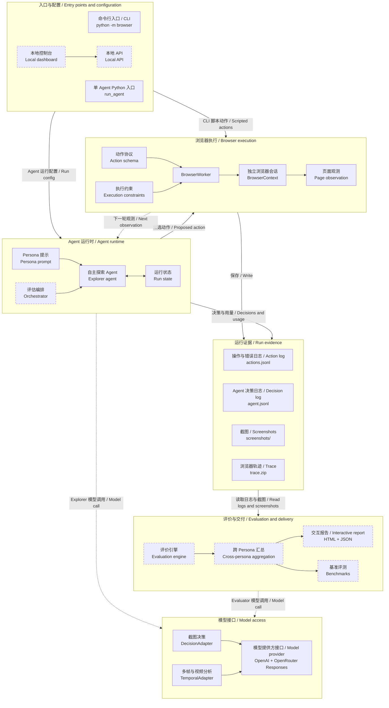

# UX-verse

## 浏览器基础 / Browser foundation

第一阶段提供一个本地 Playwright Worker。它按顺序执行浏览器操作，并保存每步的页面证据，供后续探索与评估使用。

Phase 1 provides a local Playwright worker that executes browser actions in order and saves page evidence for each step. Later phases use that evidence for exploration and evaluation.

## 项目架构 / Project architecture

实线方框表示已实现的模块和产物，虚线方框表示规划中的模块。箭头表示调用或数据流。

Solid boxes show implemented modules and artifacts. Dashed boxes show planned modules. Arrows show calls or data flow.



浏览器层接收结构化动作，返回页面观测并保存运行证据。单 Agent Explorer 将观测、任务和 Persona 提示交给模型接口，校验下一步动作，再交给浏览器执行。评价引擎将读取已保存的动作和截图，核对预期和实际结果。后续的多 Persona 编排会为每个 Agent 分配独立的浏览器会话。

The browser layer accepts structured actions, returns page observations, and saves run evidence. A single Explorer sends the observation, task, and Persona prompt through the model interface, validates the proposed action, then hands it to the browser. The planned evaluation engine will read saved actions and screenshots to compare expectations with outcomes. The future multi-persona orchestrator will assign a separate browser session to each agent.

| 模块 / Module | 职责 / Responsibility |
| --- | --- |
| 动作与执行 / Actions and execution | [`actions.py`](browser/actions.py) 定义并校验 Pydantic 动作模型。[`worker.py`](browser/worker.py) 用 Playwright 和 Chromium 执行动作，约束步数、超时与请求，并采集 URL、标题与截图。 `actions.py` defines and validates Pydantic action models. `worker.py` executes them with Playwright and Chromium, applies limits and request filters, and captures URLs, titles, and screenshots. |
| 编排与状态 / Orchestration and state | 单 Agent 引擎跟踪动作历史、预算、重试和模型用量。规划中的编排器按 Persona 分配任务、视口和预算。 The single-agent engine tracks action history, budgets, retries, and model usage. The planned orchestrator assigns tasks, viewports, and budgets by Persona. |
| 模型适配 / Model adapters | `DecisionAdapter` 为 Explorer 提议动作或停止。`TemporalAdapter` 从带时间戳的帧或视频提取页面变化。两者可独立选择模型，并共享 `ModelProvider` 接口。 `DecisionAdapter` proposes actions or stops for the Explorer. `TemporalAdapter` identifies visible changes from timestamped frames or video. Both select their model independently and share the `ModelProvider` interface. |
| 评价与交付 / Evaluation and delivery | 评价引擎按量表分析视觉与易用性，汇总器对发现去重并保留路径和分歧。基准评测衡量任务完成率、已知问题发现率与成本。 The evaluator applies visual and usability rubrics. Aggregation deduplicates findings and preserves paths and disagreements. Benchmarks measure task success, known-issue recall, and cost. |

更长期的扩展包括接入替代交互执行策略、调整探索预算分配，以及将本地任务迁移到托管的浏览器 Worker。

Longer-term extensions include alternative interaction strategies, adaptive exploration budgets, and moving local jobs to hosted browser workers.

## 运行 / Run

使用 Python 3.12 或更高版本及 `uv`。在仓库根目录安装依赖与 Chromium，然后用目标网址开启一次运行。

Use Python 3.12 or later and `uv`. From the repository root, install the dependencies and Chromium, then start a run with the target URL.

```sh
uv sync --locked
uv run --locked playwright install chromium
uv run --locked python -m browser https://example.com
```

用 `--actions actions.json` 提供初始导航后的动作列表。支持 `navigate`（`url`）、`click` 和 `hover`（`x`、`y`）、`type`（`x`、`y`、`text`）、`scroll`（`dx`、`dy`）、`back` 和 `wait`（`ms`）。`type` 点击指定位置的可编辑输入框，替换内容并触发输入事件，不按回车或提交表单。指针坐标以截图左上角为原点，单位为 CSS 像素。用 `--headed` 可以看到浏览器窗口。

Pass `--actions actions.json` to supply actions after initial navigation. Supported actions are `navigate` (`url`), `click` and `hover` (`x`, `y`), `type` (`x`, `y`, `text`), `scroll` (`dx`, `dy`), `back`, and `wait` (`ms`). `type` clicks an editable field at the supplied coordinates, replaces its contents, and fires input events without pressing Enter or submitting the form. Pointer coordinates use CSS pixels from the top-left corner of the screenshot. Use `--headed` to show the browser window.

```json
[
  {"type": "scroll", "dy": 600},
  {"type": "wait", "ms": 200}
]
```

Worker 面向本地或其他受信且已授权的站点。同源请求过滤和独立浏览器会话用于控制测试范围。运行不受信的站点需要在运行环境中提供独立网络隔离。

Use the worker on local or other trusted, authorized sites. Same-origin request filtering and an independent browser session scope each run. Testing untrusted sites requires separate network isolation in the runtime environment.

## 单 Agent 自主探索 / Single-agent exploration

也可以使用本地视觉模型，无需云端 API key。Hugging Face 权重下载、Windows CUDA 启动与 mock 实测复现步骤见 [本地模型说明](docs/local-model.md)。

Local vision models are also supported without a cloud API key. See [Local model setup](docs/local-model.md) for Hugging Face downloads, Windows CUDA startup, and reproducing the mock-site run.

在环境里设置 `OPENAI_API_KEY` 或 `OPENROUTER_API_KEY`，再通过 `UX_VERSE_DECISION_MODEL` 指定支持图片输入和 JSON 输出的模型 ID。把 `DecisionAdapter` 传给 `run_agent` 即可运行。自定义决策适配器也可以实现 [`ExplorerModel`](agent/model.py) 协议。`AgentConfig.model_timeout_seconds` 控制单次模型调用时限。

Set `OPENAI_API_KEY` or `OPENROUTER_API_KEY` in the environment. Set `UX_VERSE_DECISION_MODEL` to a model ID with image input and JSON output. Pass `DecisionAdapter` to `run_agent`. Custom decision adapters can implement the `ExplorerModel` protocol. `AgentConfig.model_timeout_seconds` controls the per-call model timeout.

打开 Waymark 测试站后，可以用命令行启动一轮 OpenRouter 决策测试。`--max-steps` 限制浏览器动作，`--max-output-tokens` 限制每次模型调用的输出长度。模型调用可能因临时失败或无效响应而重试。

With Waymark running, use the command line to start an OpenRouter decision test. `--max-steps` caps browser actions and `--max-output-tokens` caps each model response. The engine may retry a transient failure or invalid decision.

`--structured-output` 要求模型支持 JSON Schema。模型返回 0–1000 的指针坐标，适配器将其换算为 Playwright 使用的视口像素。滚动距离以像素表示。

`--structured-output` requires JSON Schema support from the model. The adapter converts pointer coordinates on a 0–1000 scale to Playwright viewport pixels. Scroll deltas use pixels.

```sh
uv run --locked python -m agent http://127.0.0.1:8765/ \
  --provider openrouter --model google/gemini-2.5-flash-lite \
  --task "Starting at Waymark's homepage, use the route directory to find and open the route named exactly Fern Creek Loop. On its detail page, read the first sentence under Parking & access. As soon as that sentence is visible, stop and report where to park in your reason." \
  --persona "First-time visitor checking trailhead parking" \
  --max-steps 8 --max-output-tokens 256 --structured-output
```

```python
import asyncio
import os
from pathlib import Path

import httpx

from agent.engine import AgentConfig, run_agent
from models.decision import DecisionAdapter
from models.responses import ResponsesProvider


async def explore():
    config = AgentConfig(
        target="https://example.com",
        task="Find the link for more information.",
        persona="First-time visitor",
        max_steps=5,
    )
    async with httpx.AsyncClient(timeout=30) as client:
        provider = ResponsesProvider("openai", client)
        model = DecisionAdapter(provider, os.environ["UX_VERSE_DECISION_MODEL"])
        return await run_agent(config, model, Path("runs/explorer-example"))


print(asyncio.run(explore()))
```

### 人类输入与截图观测 / Human input and screenshot observations

引擎打开调用方指定的起始页后，模型只收到页面视口截图、自己执行过的动作、从截图比较得出的变化，以及任务和预算。模型可以点击、悬停、滚动、逐键输入、按 Tab、Shift+Tab、Escape、上下方向键或 Enter，也可以等待、完成或放弃。连续重复且画面无变化的动作会触发一次改选。输出的 `answer` 和停止理由分别记录。

After the engine opens the caller's start page, the model receives only the viewport screenshot, its own actions, changes derived by comparing screenshots, and its task and budget. It can click, hover, scroll, type using key events, press Tab, Shift+Tab, Escape, Up, Down or Enter, wait, complete, or give up. Repeated actions with unchanged screenshots can trigger one retry. The reported `answer` and stopping reason are recorded separately.

Agent 运行入口禁用 DOM 控件和文本提示、自动定位、程序化查找与返回。截图范围是页面视口，浏览器地址栏、原生查找和原生返回尚未接入。文本输入目前支持最多 1000 个可打印 ASCII 字符，由虚拟键盘逐键执行。独立浏览器脚本仍可使用其原有工具。录制、诊断日志和基准验收可保存内部证据，模型决策输入保持截图范围。

The agent entry point disables DOM control and text hints, automatic link location, and programmatic find and back. Capture covers the page viewport. The address bar, native browser find, and native back are outside the current input surface. Text input currently supports up to 1000 printable ASCII characters through virtual key presses. The standalone browser runner retains its scripting tools. Recording, diagnostics, and benchmark verification can retain internal evidence while model input remains scoped to screenshots.

### Explorer 实测基准 / Explorer live benchmark

启动本地视觉模型后，从仓库根目录运行以下命令。工具会启动独立 Waymark 服务，并测试 Waymark、Python 3.12 文档和 IANA 公开页面。每轮交叉检查最终页面、视口中的预期内容和模型回答。运行结果及截图、浏览器日志和 trace 会保存在新建的 `runs/benchmark-*` 目录中。

Start the local vision model and run the following from the repository root. The tool starts an isolated Waymark server and tests Waymark, the Python 3.12 docs, and public IANA pages. Each run checks the final page, the expected content in the viewport, and the model answer. Results, screenshots, browser logs, and traces are saved in a new `runs/benchmark-*` directory.

```sh
uv run --locked python -m tools.explorer_benchmark --repeats 2
```

### 虚拟鼠标与键盘 / Virtual mouse and keyboard

Agent 和浏览器脚本共用同一套虚拟输入设备。模型仍选择点击、悬停、滚动、按键或输入文字。虚拟鼠标维护当前坐标，虚拟键盘负责组合键和文字输入。

The agent and scripted browser share the same virtual input devices. The model still chooses a click, hover, scroll, key press, or text action. The virtual mouse tracks its current coordinates, and the virtual keyboard handles key chords and text entry.

- Agent 在点击、悬停和聚焦输入框前移动到目标。`--pointer-mode continuous`（默认）使用直线缓动。`--pointer-mode cursory` 使用 [Cursory](https://github.com/Vinyzu/cursory) 根据真人记录生成带时间戳的轨迹，由 Playwright 执行。独立浏览器脚本也支持这两种模式，它的默认值是 `--pointer-mode direct`。
- The agent moves to its target before clicking, hovering, or focusing a text field. `--pointer-mode continuous` (default) follows an eased straight line. `--pointer-mode cursory` uses [Cursory](https://github.com/Vinyzu/cursory) to generate a timed path based on recorded human motion, which Playwright executes. The standalone browser runner also supports both modes and defaults to `--pointer-mode direct`.
- Agent 的一次滚动会在当前指针位置发送一串先加速、后减速的滚轮事件。每个方向的增量之和等于 Agent 请求的像素数，页面和可滚动容器按浏览器的规则响应。独立浏览器脚本的滚动仍发送单次滚轮事件。
- One agent scroll sends a series of wheel events at the current pointer position, accelerating and then easing to a stop. The deltas on each axis add up to the requested pixels. Pages and scrollable containers respond according to browser behavior. Scripted browser runs continue to send a single wheel event per scroll.
- 独立浏览器脚本支持 `--text-input insert`（默认）与 `--text-input sequential`。Agent 固定使用逐键输入。
- The standalone browser runner supports `--text-input insert` (default) and `--text-input sequential`. The agent always uses individual key presses.

启动本地视觉模型后，可运行以下 Waymark 任务。基准测试独立核对结果，并保存 `inputs.jsonl` 和带指针的视频以便检查轨迹。

With the local vision model running, use the following Waymark task. The benchmark independently checks the result and saves `inputs.jsonl` and a video with the pointer for trajectory inspection.

```sh
uv run --locked python -m tools.explorer_benchmark --group mock --case parking --repeats 1 --pointer-mode cursory --record-input
```

### 实跑视频与输入录制 / Live video and input recording

为 `python -m agent`、`python -m browser` 或 `python -m tools.explorer_benchmark` 加上 `--record-input`，即可在浏览器运行期间同步录制。无头和可见窗口都可以使用。录制依赖 Playwright 的视频组件，缺失时运行 `uv run --locked playwright install ffmpeg`。

Add `--record-input` to `python -m agent`, `python -m browser`, or `python -m tools.explorer_benchmark` to capture the live browser run. The recorder works in both headless and headed Chromium. If Playwright's video runtime is missing, run `uv run --locked playwright install ffmpeg`.

| 文件 / File | 内容 / Contents |
| --- | --- |
| `videos/*.webm` | Playwright 编码的页面视频。指针随浏览器产生的实际指针事件在录制时更新。 Playwright page video. The pointer overlay updates live from browser-generated pointer events. |
| `agent.jsonl`、`actions.jsonl` | 模型选中的决策和浏览器执行结果，包含所选输入文字和虚拟键。 Model decisions and executed actions, including chosen text and virtual keys. |
| `inputs.jsonl` | 下发命令和浏览器收到的指针、点击、滚轮、按键、文字插入及组合输入事件。 Dispatch commands and observed pointer, click, wheel, key, text input, and composition events. |
| `recording.json` | 录制状态、页面 ID 与视频轨道路径。 Recording status, page IDs, and video track paths. |

输入事件携带浏览器事件时间、页面与 frame ID，以及 frame 内 CSS 像素坐标。浏览器提供合并采样时，也会保存这些中间点。命令、浏览器动作和模型决定通过运行 ID、动作 ID 与决策 ID 关联。录制器独立采集 Chromium 实际收到的中间位置。视频按帧采样，验证细节时可查事件日志。模型截图会隐藏录制指针。采集范围是浏览器页面，包含在页面中收到的系统输入。

Input events carry browser event time, page and frame IDs, and frame-local CSS-pixel coordinates. Coalesced samples are preserved when Chromium supplies them. Commands, browser actions, and model decisions are linked by run, action, and decision IDs. The recorder independently captures intermediate positions received by Chromium. The event log preserves detail between video frames. Model screenshots hide the recording pointer. The capture covers browser pages, including native input delivered to them.

指针有实际位置后，在停顿和同一页面窗口内导航时会保留其最后位置，直到收到新的输入或指针离开视口。

Once the recorder has observed a pointer position, it retains that position during pauses and navigation in the same page window until new input arrives or the pointer leaves the viewport.

录制会保存实际输入的键和文字，请仅对可以保留此类输入的会话启用。

Recording stores actual keys and entered text. Enable it for sessions where those inputs can be retained.

### 时序分析与视频 / Temporal and video analysis

使用 [`TemporalAdapter`](models/temporal.py) 分析已有页面证据。至少两张带递增毫秒时间戳的帧可以走 OpenAI 或 OpenRouter 的图像模型。MP4 或 WebM 片段走 OpenRouter，所选模型及其路由须支持相应的原生视频输入和 JSON 输出。返回结果包含摘要、按时间排序的变化、实际模型 ID 和提供方报告的用量。帧分析的时间戳必须来自输入帧，视频中的时间戳是从片段开头估计的相对时间。

Use `TemporalAdapter` to analyze page evidence you have already captured. Two or more frames with increasing millisecond timestamps can go to an OpenAI or OpenRouter vision model. Use OpenRouter for an MP4 or WebM clip, with a model and route that support the video format and JSON output. Results include a summary, chronological changes, the resolved model ID, and usage reported by the provider. Frame-based results cite supplied timestamps. Video timestamps are estimates relative to the start of the clip.

```python
import os
from pathlib import Path

import httpx

from models.contracts import ImageInput, VideoInput
from models.responses import ResponsesProvider
from models.temporal import TemporalAdapter, TimedFrame


async def analyze_frames(before: Path, after: Path, after_ms: int):
    frames = (
        TimedFrame(0, ImageInput(before.read_bytes())),
        TimedFrame(after_ms, ImageInput(after.read_bytes())),
    )
    async with httpx.AsyncClient(timeout=60) as client:
        provider = ResponsesProvider("openai", client)
        model = TemporalAdapter(provider, os.environ["UX_VERSE_TIMELINE_MODEL"])
        return await model.analyze("Describe the feedback after the click.", frames)


async def analyze_recording(recording: Path):
    video = VideoInput(recording.read_bytes(), "video/webm")
    async with httpx.AsyncClient(timeout=90) as client:
        provider = ResponsesProvider("openrouter", client)
        model = TemporalAdapter(provider, os.environ["UX_VERSE_VIDEO_MODEL"])
        return await model.analyze("Describe the visible page transitions.", video)
```

模型接入层接收调用方提供的媒体。调用上述在线适配器时，截图、帧或视频会随请求发送到选定的模型服务。

The model layer accepts media supplied by the caller. When using the hosted adapters above, requests send screenshots, frames, or video to the selected model service.

## 运行产物 / Run outputs

默认写入 `runs/` 下的新目录。用 `--output` 可指定一个尚不存在的目录。

By default, each run writes to a new directory under `runs/`. Use `--output` to choose a directory that does not exist yet.

| 文件 / File | 内容 / Contents |
| --- | --- |
| `actions.jsonl` | 结构化操作、URL、耗时、结果、截图路径及浏览器错误事件。 Structured actions, URLs, durations, outcomes, screenshot paths, and browser errors. |
| `screenshots/` | 每次成功操作后的 1280 × 720 PNG。 A 1280 × 720 PNG after each successful action. |
| `trace.zip` | 用 Playwright Trace Viewer 查看浏览器轨迹。 Browser trace for the Playwright Trace Viewer. |
| `agent.jsonl` | Agent 运行的决策、模型请求、模型 ID、用量和停止原因，关联观测截图。 Explorer decisions, requests, model IDs, usage, and stop reasons linked to observation screenshots. |

### 关联运行事件 / Correlate run events

[`logs/`](logs/) 统一定义事件模型与 JSONL 读写。`RunEvents` 为同次运行的两份日志分配同一个 `run_id` 和跨文件连续的 `seq`，以 UTC 记录事件时间。`RunEvent` 校验来源、带时区的时间、版本和关联 ID。合并同一 `run_id` 的日志后按 `seq` 排序即可查看写入顺序。单独运行浏览器命令时，也会生成自己的运行 ID。

`logs/` owns the event models and JSONL I/O. `RunEvents` assigns a shared `run_id` and a sequence number `seq` that spans both files, and records timestamps in UTC. `RunEvent` validates the source, timezone-aware timestamp, schema version, and correlation IDs. Merge records with the same `run_id` and sort by `seq` to recover write order. Standalone browser runs get their own run ID.

`logs.read_log(path)` 支持带 `schema_version: 1` 的日志和早期未标版本的日志。早期事件保留已有字段和文件内顺序。新模块可以扩展事件类型和字段，读取时会保留这些附加字段。如果字段含义发生不兼容的变化，增加一个版本并保留对应读取规则。读取未知版本时会明确报错。

`logs.read_log(path)` reads logs with `schema_version: 1` and older unversioned logs. Legacy records retain their fields and order within each file. New modules can add event types and fields, which the reader preserves. Use a new version and retain the appropriate reader when a field changes incompatibly. The reader reports unsupported versions explicitly.

| 字段 / Field | 如何关联 / How to join |
| --- | --- |
| `decision_id` | 同一次决策的模型请求、重试和结果共享该 ID。 Model requests, retries, and the result for one decision share this ID. |
| `action_id` | 将已接受的 Agent 动作与 Worker 记录的实际执行关联起来。浏览器诊断在动作执行窗口内也会带上该 ID。 Links an accepted Agent action to its browser execution. Browser diagnostics within that action window also carry this ID. |
| `observation_id` | `model_requested` 引用模型看到的观测。浏览器动作的 `before_observation_id` 指向上一张截图，成功动作的 `observation` 含新 ID 和截图路径。 `model_requested` references the model input. A browser action's `before_observation_id` points to the previous screenshot, and a successful action carries the new ID and screenshot path inside `observation`. |

停止决定和超预算的动作提议仍记录为模型决定，浏览器执行记录只对应已派发的动作。初始导航是浏览器动作，第一张截图从这里产生。

Stop decisions and over-budget proposals are recorded as model decisions. Browser execution records correspond to dispatched actions. Initial navigation is a browser action and produces the first screenshot.

## 验证 / Verify

Waymark 测试站提供响应式路线目录、详情、收藏、FAQ 和模拟联系表单。可以比较正常版与预置问题版，启动命令和复现表见 [`mock/README.md`](mock/README.md)。

The Waymark test site includes a responsive route catalog, detail pages, favorites, FAQ, and a simulated contact form. Compare the baseline and seeded variants using the startup command and reproduction table in `mock/README.md`.

测试覆盖本地浏览器运行、Agent 决策循环、在线适配器请求格式、视频与多帧响应校验、错误分类和证据保存。模型服务用模拟 HTTP 响应验证。

Tests cover local browser runs, the agent loop, hosted adapter payloads, video and frame response validation, error classification, and evidence capture. Provider tests use mocked HTTP responses.

```sh
uv run --locked python -m unittest discover -s tests -v
```

[设计文档 / Design document](docs/design.md)
