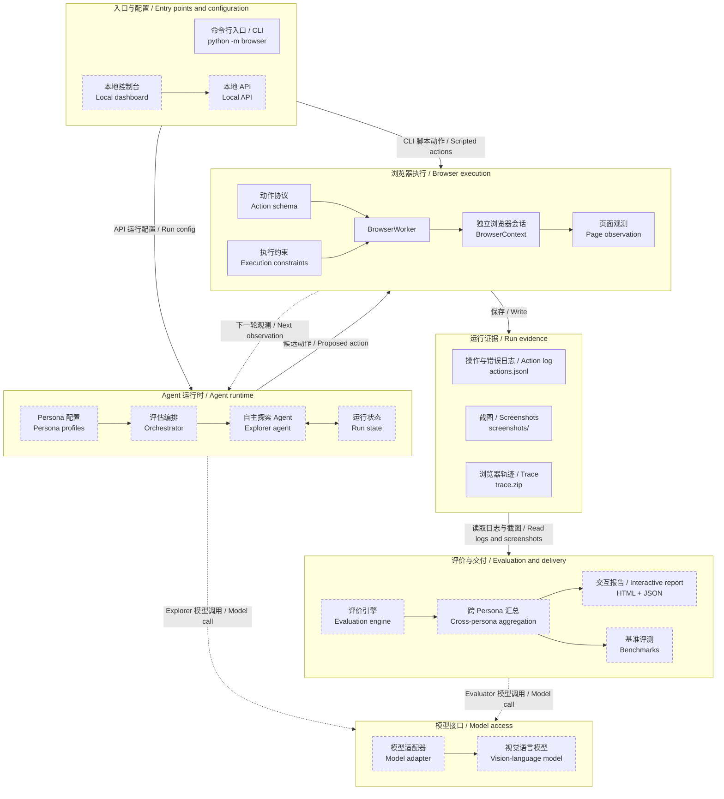

# UX-verse

## 浏览器基础 / Browser foundation

第一阶段提供一个本地 Playwright Worker。它按顺序执行浏览器操作，并保存每步的页面证据，供后续探索与评估使用。

Phase 1 provides a local Playwright worker that executes browser actions in order and saves page evidence for each step. Later phases use that evidence for exploration and evaluation.

## 项目架构 / Project architecture

实线方框表示第一阶段已实现的模块和产物，虚线方框表示规划中的模块。箭头表示调用或数据流。

Solid boxes show modules and artifacts delivered in Phase 1. Dashed boxes show planned modules. Arrows show calls or data flow.



浏览器层接收结构化动作，返回页面观测并保存运行证据。后续 Explorer 将观测和 Persona 配置转成下一步动作，评价引擎则读取已保存的动作与截图，核对预期和实际结果。多 Persona 运行时，每个 Agent 使用独立的浏览器会话。

The browser layer accepts structured actions, returns page observations, and saves run evidence. The planned Explorer turns observations and Persona settings into the next action. The evaluation engine reads saved actions and screenshots to compare expectations with outcomes. Each agent uses its own browser session in multi-persona runs.

| 模块 / Module | 职责 / Responsibility |
| --- | --- |
| 动作与执行 / Actions and execution | [`actions.py`](browser/actions.py) 定义并校验 Pydantic 动作模型。[`worker.py`](browser/worker.py) 用 Playwright 和 Chromium 执行动作，约束步数、超时与请求，并采集 URL、标题与截图。 `actions.py` defines and validates Pydantic action models. `worker.py` executes them with Playwright and Chromium, applies limits and request filters, and captures URLs, titles, and screenshots. |
| 编排与状态 / Orchestration and state | 编排器按 Persona 分配任务、视口和预算。运行状态记录历史、重试与模型用量。 The orchestrator assigns tasks, viewports, and budgets by Persona. Run state tracks history, retries, and model usage. |
| 模型适配 / Model adapter | Explorer 请求选择动作并预测结果。Evaluator 请求解释和核验问题。适配器统一提供方接口与结构化响应。 The Explorer requests actions and outcome predictions. The Evaluator requests explanations and verification. The adapter provides a shared interface for providers and structured responses. |
| 评价与交付 / Evaluation and delivery | 评价引擎按量表分析视觉与易用性，汇总器对发现去重并保留路径和分歧。基准评测衡量任务完成率、已知问题发现率与成本。 The evaluator applies visual and usability rubrics. Aggregation deduplicates findings and preserves paths and disagreements. Benchmarks measure task success, known-issue recall, and cost. |

更长期的扩展包括接入替代交互执行策略、调整探索预算分配，以及将本地任务迁移到托管的浏览器 Worker。

Longer-term extensions include alternative interaction strategies, adaptive exploration budgets, and moving local jobs to hosted browser workers.

## 运行 / Run

使用 Python 3.12 或更高版本及 `uv`。在仓库根目录安装依赖与 Chromium，然后用目标网址开启一次运行。

Use Python 3.12 or later and `uv`. From the repository root, install the dependencies and Chromium, then start a run with the target URL.

```sh
uv sync --locked
uv run --locked playwright install chromium
uv run --locked python -m browser https://example.com
```

用 `--actions actions.json` 提供初始导航后的动作列表。支持 `navigate`（`url`）、`click` 和 `hover`（`x`、`y`）、`scroll`（`dx`、`dy`）、`back` 和 `wait`（`ms`）。指针坐标以截图左上角为原点，单位为 CSS 像素。用 `--headed` 可以看到浏览器窗口。

Pass `--actions actions.json` to supply actions after initial navigation. Supported actions are `navigate` (`url`), `click` and `hover` (`x`, `y`), `scroll` (`dx`, `dy`), `back`, and `wait` (`ms`). Pointer coordinates use CSS pixels from the top-left corner of the screenshot. Use `--headed` to show the browser window.

```json
[
  {"type": "scroll", "dy": 600},
  {"type": "wait", "ms": 200}
]
```

Worker 面向本地或其他受信且已授权的站点。同源请求过滤和独立浏览器会话用于控制测试范围。运行不受信的站点需要在运行环境中提供独立网络隔离。

Use the worker on local or other trusted, authorized sites. Same-origin request filtering and an independent browser session scope each run. Testing untrusted sites requires separate network isolation in the runtime environment.

## 运行产物 / Run outputs

默认写入 `runs/` 下的新目录。用 `--output` 可指定一个尚不存在的目录。

By default, each run writes to a new directory under `runs/`. Use `--output` to choose a directory that does not exist yet.

| 文件 / File | 内容 / Contents |
| --- | --- |
| `actions.jsonl` | 结构化操作、URL、耗时、结果、截图路径及浏览器错误事件。 Structured actions, URLs, durations, outcomes, screenshot paths, and browser errors. |
| `screenshots/` | 每次成功操作后的 1280 × 720 PNG。 A 1280 × 720 PNG after each successful action. |
| `trace.zip` | 用 Playwright Trace Viewer 查看浏览器轨迹。 Browser trace for the Playwright Trace Viewer. |

## 验证 / Verify

测试会启动本地网页，通过命令行执行浏览器操作并验证截图、操作记录和 Trace。

The tests start a local site, execute browser actions through the CLI, and verify screenshots, action logs, and the trace.

```sh
uv run --locked python -m unittest discover -s tests -v
```

[设计文档 / Design document](docs/design.md)
